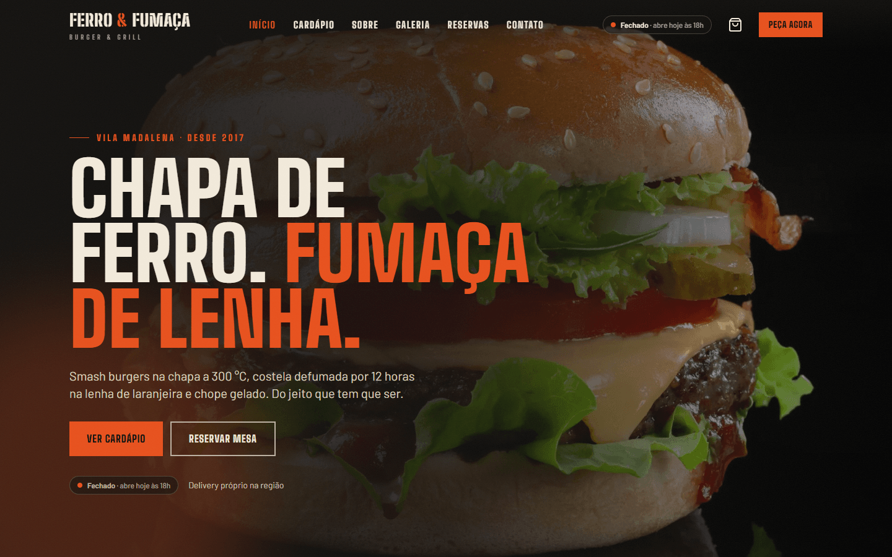
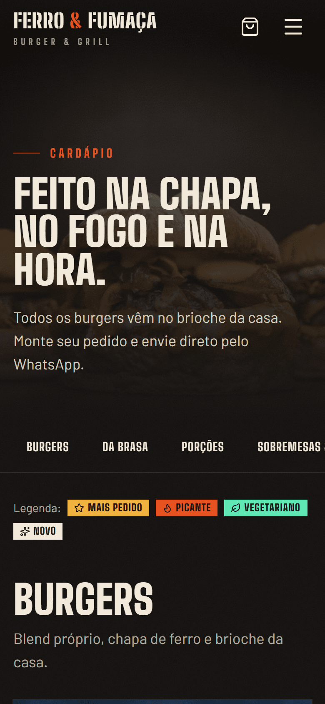
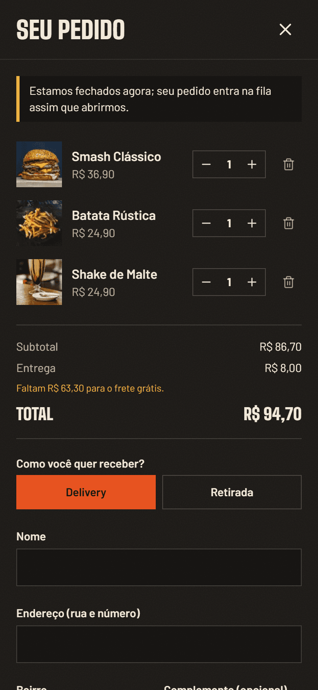
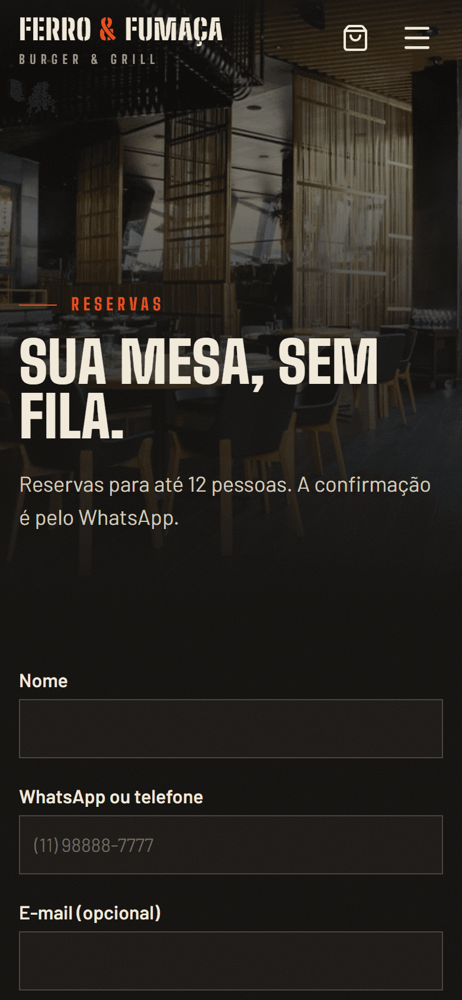

# Ferro & Fumaça — Burger & Grill

> **Restaurante fictício — projeto de portfólio.** Nome, endereço, telefone, cardápio e depoimentos são inventados.

Site completo de uma hamburgueria/steakhouse: seis páginas, cardápio digital com carrinho e **pedido enviado pelo WhatsApp**, reserva de mesa com validação, galeria com visualizador e status "aberto/fechado" calculado ao vivo no horário de São Paulo.

**Ao vivo:** https://ferro-e-fumaca.vercel.app



| Cardápio no celular | Pedido no celular | Reservas |
|---|---|---|
|  |  |  |

## Recursos

- **Seis abas:** Início, Cardápio, Sobre, Galeria, Reservas, Contato, além de uma página 404 própria.
- **Cardápio digital:**
  - 26 itens em 5 categorias;
  - navegação fixa que acompanha a rolagem;
  - selos (mais pedido, picante, vegetariano, novo).
- **Carrinho:**
  - fica salvo no navegador e permite delivery ou retirada;
  - calcula taxa e frete grátis a partir de R$ 150;
  - gera a mensagem do pedido formatada para o WhatsApp.
- **Reservas:**
  - horários gerados conforme o funcionamento de cada dia, e segunda-feira (dia fechado) é recusada;
  - máscara de telefone;
  - confirmação com código e envio pelo WhatsApp.
- **Galeria:** filtros e visualizador em tela cheia, com teclado e deslize no celular.
- **Status "Aberto agora / Fechado":** sempre no fuso de São Paulo, de onde quer que o visitante acesse.
- **Compartilhamento:** imagem gerada automaticamente para a prévia do link (WhatsApp, LinkedIn), metadados por página e JSON-LD.
- **Acessibilidade:** navegação por teclado, foco visível, diálogos acessíveis e respeito a "reduzir movimento".

## Stack

Next.js 16 (App Router, páginas estáticas) · React 19 · TypeScript · Tailwind CSS 4 · lucide-react · Vitest · Playwright

## Como rodar

```bash
npm install
npm run dev          # http://localhost:3000
npm test             # testes das regras (Vitest)
npm run test:e2e     # testes no navegador (Playwright, usa o Microsoft Edge)
```

## Como adaptar para um restaurante de verdade

Todo o conteúdo está separado do código:

| Arquivo | O que trocar |
|---|---|
| `src/data/site.ts` | nome, endereço, telefone, **número do WhatsApp**, Instagram, horários, taxa de entrega |
| `src/data/menu.ts` | pratos, preços, descrições, selos e fotos |
| `src/data/gallery.ts`, `faq.ts`, `testimonials.ts`, `timeline.ts` | galeria, perguntas, depoimentos, história |
| `scripts/images.manifest.json` | fotos (baixe com `node scripts/fetch-images.mjs`) |

Com o número do WhatsApp preenchido, pedidos e reservas chegam direto no celular do restaurante.

## Estrutura

```
src/
  app/          páginas, layout, imagem de compartilhamento
  components/   cabeçalho, carrinho, cardápio, galeria, reservas...
  data/         conteúdo do restaurante
  lib/          regras puras e testadas (preço, horários, carrinho, reserva, WhatsApp)
  hooks/        relógio, rolagem, foco, trava de scroll
tests/
  unit/         Vitest
  e2e/          Playwright
```

## Créditos

Fotos do [Unsplash](https://unsplash.com) (Licença Unsplash). A lista com o link de cada foto está em [`scripts/images.manifest.json`](scripts/images.manifest.json) (`https://images.unsplash.com/photo-<id>`).

Desenvolvido por **Raphael Elias Senhorinho**.
